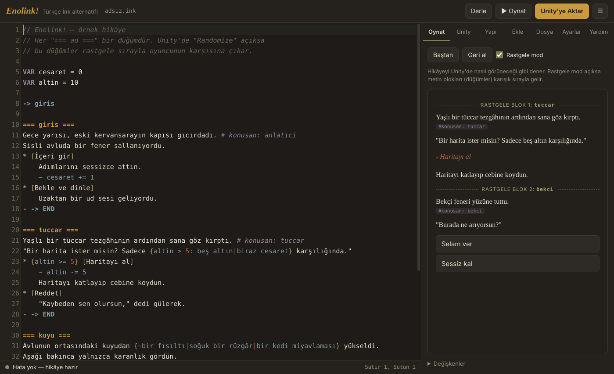
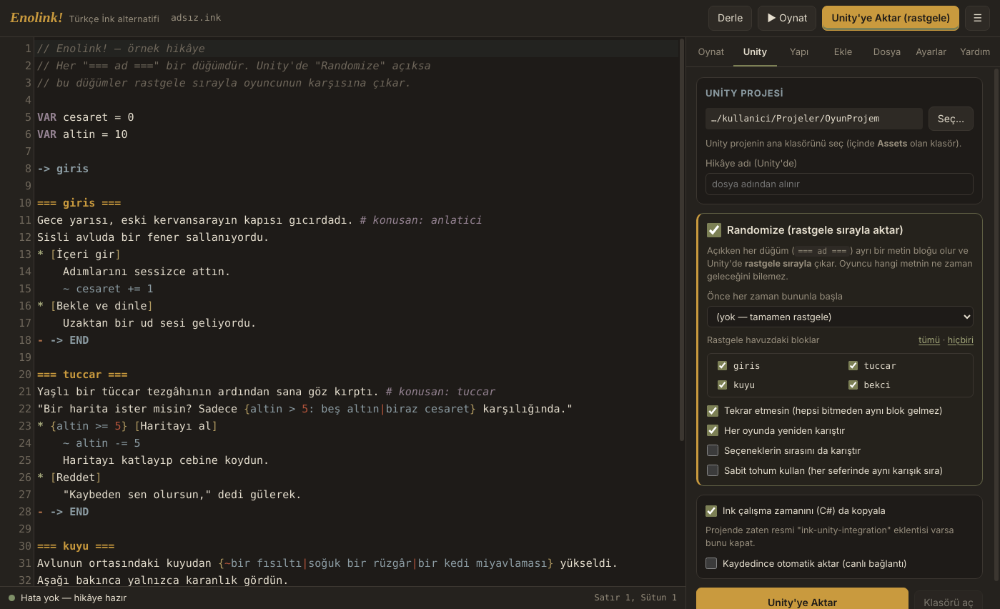
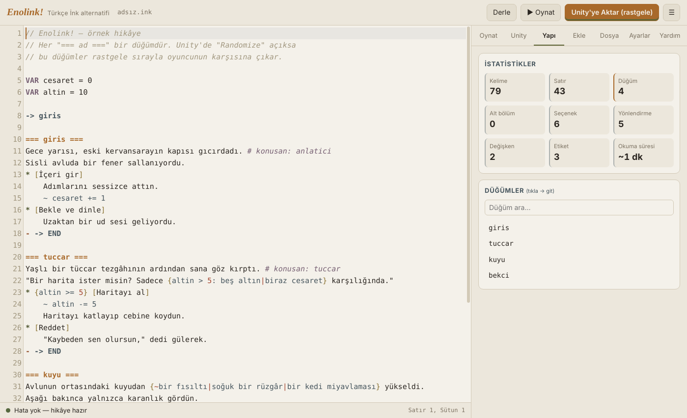

# Enolink! — Türkçe İnk alternatifi

**Enolink!**, [inkle'ın ink](https://github.com/inkle/ink) anlatı dilini kullanan, tamamen Türkçe arayüzlü bir hikâye editörüdür. Hikâyeni yazarsın, anında denersin ve tek tuşla Unity projene aktarırsın. **Randomize** seçeneğiyle metin blokları oyunda rastgele sırayla çıkar; oyuncu hangi metnin ne zaman geleceğini bilemez.



## İndir

[**Releases**](../../releases/latest) sayfasından:

| Sistem | Dosya | Nasıl? |
|---|---|---|
| Windows 11 | `Enolink-x.y.z-Kurulum.exe` | Çalıştır, kur. Başlat menüsü + masaüstü kısayolu + `.ink` dosya ilişkilendirmesi ekler. |
| Windows 11 (taşınabilir) | `Enolink-x.y.z-win-x64-tasinabilir.zip` | Aç, `Enolink.exe`'yi çalıştır. |
| CachyOS / Arch / her Linux | `Enolink-x.y.z-x86_64.AppImage` | `chmod +x` yap ve çalıştır. |
| CachyOS / Arch (paket) | `Enolink-x.y.z-linux-x64.tar.gz` + `PKGBUILD` | İkisini aynı klasöre koy, `makepkg -si`. |
| Diğer Linux | `Enolink-x.y.z-linux-x64.tar.gz` | Aç, `./kur.sh` (root gerekmez). |

> Windows SmartScreen "bilgisayarınızı korudu" diyebilir; uygulama imzasız olduğu için normaldir: **Ek bilgi → Yine de çalıştır**.

## Özellikler

- **Tamamen Türkçe**: menüler, panel, derleyici hata mesajları, yardım ve örnek hikâye.
- **Tek panelde her şey**: Oynat · Unity · Yapı · Ekle · Dosya · Ayarlar · Yardım.
- **Canlı derleme**: yazarken hatalar satırında işaretlenir, tıklayınca o satıra gidilir.
- **Oynatıcı**: hikâyeyi dene, son seçimi geri al, değişkenleri izle, etiketleri (`# konusan: ...`) gör.
- **Unity'ye aktar**: derlenmiş hikâye + C# betikleri `Assets/Enolink` klasörüne yazılır. İstersen her kaydedişte otomatik aktarılır.
- **Randomize**: her düğüm (`=== ad ===`) ayrı bir metin bloğu olur ve Unity'de karışık sırayla gelir:
  - sabit bir başlangıç bloğu seçebilirsin,
  - havuza girecek blokları tek tek seçersin,
  - "tekrar etmesin" ile tüm bloklar bitmeden aynısı gelmez,
  - seçeneklerin sırasını da karıştırabilirsin,
  - sabit tohum ile her seferinde aynı karışık sırayı alırsın (test için).
- **24 hazır kalıp**: düğüm, seçenek, koşul, rastgele metin, liste, fonksiyon...
- **Koyu ve açık tema**, bul/değiştir, satıra git, sürükle-bırak, `INCLUDE` ile çok dosyalı hikâyeler.

| Unity aktarımı | Açık tema |
|---|---|
|  |  |

## Unity'de kullanım

1. Enolink!'te **Unity** sekmesinden projenin ana klasörünü seç ve **Unity'ye Aktar**'a bas.
2. Unity'de menüden **Enolink! → Sahneye Hikâye Yöneticisi Ekle**'yi seç.
3. Play'e bas. Hazır deneme arayüzü (`InkBasitArayuz`) hiçbir ek paket gerektirmez.

Kendi arayüzünle:

```csharp
var y = GetComponent<Enolink.InkHikayeYoneticisi>();

string satir = y.Ilerle();           // sıradaki satır (yoksa null)
string metin = y.TumunuIlerle();     // seçim noktasına kadar tüm metin
var secenekler = y.MevcutSecenekler; // List<Ink.Runtime.Choice>
y.SecimYap(0);                       // listedeki ilk seçeneği seç
y.DegiskenAl("altin");  y.DegiskenAyarla("altin", 20);
string kayit = y.KayitAl();  y.KayitYukle(kayit);
```

Olaylar: `MetinGeldi`, `SeceneklerGeldi`, `BlokBasladi`, `BlokBitti`, `HikayeBitti`. Inspector'daki **Mod** alanı ile aktarım ayarını ezebilirsin (Sıralı / Rastgele). Değişkenler bloklar arasında korunur.

> Projende resmi `ink-unity-integration` eklentisi varsa, aktarırken **"Ink çalışma zamanını da kopyala"** seçeneğini kapat.

## Geliştirme

```bash
npm install
npm start           # uygulamayı çalıştır
npm run paketle     # dist/ altına Linux + Windows paketlerini üretir (Linux'ta; nsis gerekir)
```

| Klasör / dosya | İçerik |
|---|---|
| `main.js` | Pencere, menüler, dosya diyalogları |
| `cekirdek.js` | Derleme ve Unity aktarımı |
| `renderer/` | Arayüz: editör, panel, oynatıcı |
| `unity/` | Unity'ye kopyalanan dosyalar: ink 1.2.1 C# runtime + `InkHikayeYoneticisi` + `InkBasitArayuz` |
| `paketleme/` | AppImage, tar.gz, PKGBUILD, taşınabilir zip ve NSIS kurulum betikleri |

Derleyici olarak ink'in resmi JavaScript portu [inkjs](https://github.com/y-lohse/inkjs) kullanılır. Ürettiği JSON, ink 1.2.1 C# runtime'ı ile aynı formattadır (sürüm 21).

## Lisans

MIT. ink motoru © inkle Ltd. (MIT, bkz. `LICENSE-ink.txt`). Enolink! inkle tarafından geliştirilmemiştir ve onlarla bağlantılı değildir.

### Yeni sürüm yayınlamak

`package.json` içindeki `version`'ı artır (ör. `1.0.1`), `.github/SURUM_NOTLARI.md`'yi güncelle ve `main`'e gönder. GitHub Actions paketleri derler, `v1.0.1` etiketini ve sürümü otomatik oluşturur. İstersen Actions sekmesinden **Run workflow** ile elle de başlatabilirsin.
